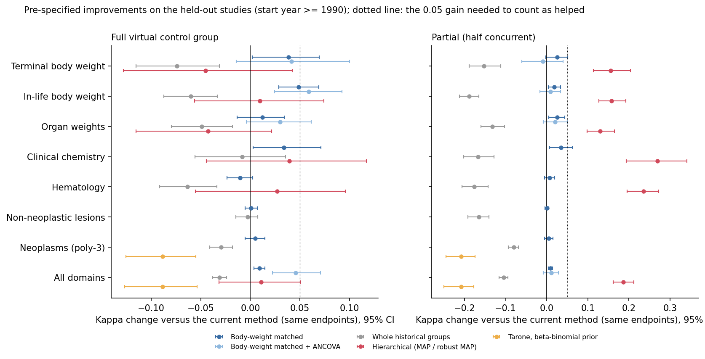
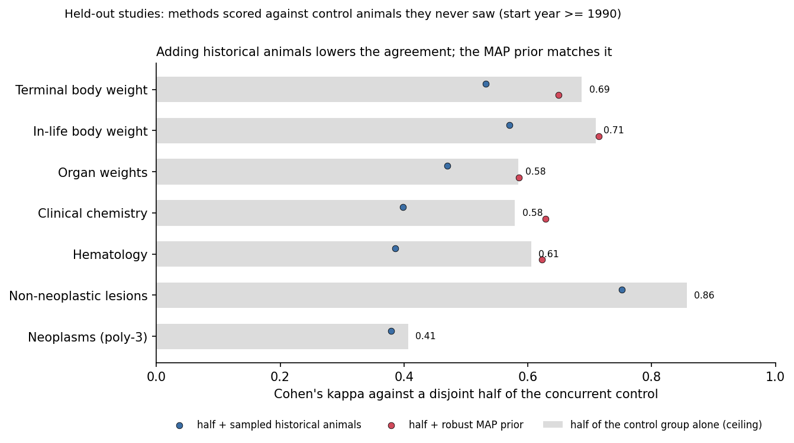

# Virtual control groups for NTP rodent toxicology studies

A proof of concept that replaces the concurrent control group of a U.S. National
Toxicology Program (NTP) rodent study with a *virtual control group* (VCG) built
from matched historical control animals of other NTP studies, and measures how
often the toxicological conclusion stays the same. Public individual-animal data
from NTP's CEBS database only.

**Headline result: with historical controls matched on species, strain, sex,
study design, route, vehicle and laboratory, a virtual control group reproduces
the concurrent-control significance conclusion for 78% of 25,243 study x sex x
endpoint units from 1,113 NTP studies (Cohen's kappa 0.52). Three quarters of the
disagreements are findings that are significant against the VCG but not against
the concurrent control. Agreement is far from uniform: 90% for non-neoplastic
lesion incidences, 81% for neoplasm incidences, but only 60-73% for clinical
pathology, organ weights and body weights, where a constant "not significant"
verdict would do about as well.**

**That 0.52 has to be read against what two control groups can agree on at all.
Splitting each real control group into two disjoint halves and testing the
treated groups against each half gives kappa 0.64 on the same endpoints. That is
the noise ceiling, and the virtual control group reaches 84% of it overall:
91-93% for lesion and tumour incidences, but under half for clinical chemistry
and hematology.**

**Three pre-specified improvements were then tested on held-out studies
(`docs/analysis_plan.md`). Body-weight matching and ANCOVA helped a little,
whole-group sampling and Tarone's test hurt. The one large gain, hierarchical
borrowing in a partial virtual control group, disappears once the comparison is
made against control animals the method never saw: adding historical animals to
half a control group makes it agree with the other half worse, and the
hierarchical prior only matches it.**


Agreement is a comparison with the concurrent control, not with the truth. Nothing
here says what the right answer for any study is; it says how often a VCG would
have led to the same answer as the real control group did.

## Method in a few sentences

1. **Data.** Individual-animal clinical chemistry, hematology, organ weights,
   terminal and in-life body weights and histopathology from NTP's DTT data
   collections in CEBS, plus the CEBS study catalog (laboratory, start year,
   route, vehicle per study). F344 rats and B6C3F1/N mice; 3-month and 2-year
   studies with a simple dose-response design.
2. **Hold-out.** For every study and sex, the concurrent control group is set
   aside. Historical control animals are taken from *other* studies (same test
   article excluded) that match the target on species, strain, sex and study
   design, then increasingly also on route, vehicle, laboratory and start year
   (five nested strictness levels).
3. **Virtual control groups.** From the matched pool, 20 random groups
   of the same size as the concurrent control are drawn per configuration. A
   *partial* VCG keeps a random half of the concurrent animals and fills the other
   half from the pool. For the drift analysis the pool is restricted to historical
   studies a given number of years away.
4. **Tests.** Treated groups are compared with the control the way a toxicologist
   would: Dunnett's test (two-sided, 5%) for continuous endpoints, Fisher's exact
   test for non-neoplastic lesion incidences in 3-month studies and the poly-3
   test (Bailer-Portier with Bieler-Williams variance, one-sided) for neoplasm
   incidences in 2-year studies. Each comparison is run once against the real
   control and once against each VCG.
5. **Pre-dosing body weight** is a matching covariate, not an endpoint. It is
   measured before any treatment, so a "treatment effect" on it can only be
   chance or a mismatch between the control groups; in the first version of this
   analysis it was the single worst endpoint (47% agreement), which flattered
   nothing and measured only the mismatch. It is now used for matching and as an
   ANCOVA covariate instead, and dropped from the evaluated endpoints for every
   method, including the baseline.
6. **Evaluation.** An endpoint is "significant" if any dose group is. Agreement is
   the share of endpoints with the same conclusion; a *false positive* is
   significant against the VCG only, a *false negative* significant against the
   concurrent control only. Rates are averaged over draws within an endpoint, then
   over endpoints.

## Results

All numbers below are from `results/tables/*.csv` and `results/summary.json`,
produced by the pipeline with the default seed. "Units" are study x sex x endpoint
combinations for which a historical pool of at least twice the concurrent group
size existed at the given matching level. Sensitivity is the share of
concurrent-significant endpoints also significant with the VCG; specificity the
share of concurrent-nonsignificant endpoints also nonsignificant with the VCG.

### Agreement by endpoint domain (matching: design + route + vehicle + laboratory)

| Endpoint domain | Units | Agreement | Baseline "never significant" | Kappa | Sensitivity | Specificity |
|---|---:|---:|---:|---:|---:|---:|
| Non-neoplastic lesions (Fisher, 3-month) | 3,085 | **0.90** | 0.58 | 0.79 | 0.93 | 0.85 |
| Neoplasms (poly-3, 2-year) | 15,409 | **0.81** | 0.84 | 0.41 | 0.65 | 0.84 |
| In-life body weight | 1,923 | 0.73 | 0.57 | 0.42 | 0.89 | 0.51 |
| Terminal body weight | 699 | 0.70 | 0.55 | 0.42 | 0.85 | 0.58 |
| Organ weights | 1,283 | 0.68 | 0.67 | 0.37 | 0.79 | 0.63 |
| Hematology | 2,051 | 0.62 | 0.67 | 0.28 | 0.81 | 0.52 |
| Clinical chemistry | 793 | 0.60 | 0.63 | 0.25 | 0.82 | 0.47 |
| **All endpoints** | 25,243 | **0.78** | 0.72 | 0.52 | 0.80 | 0.78 |

Two things stand out. First, the raw agreement for continuous endpoints is no
better than the trivial baseline of always calling the endpoint non-significant;
the VCG finds most of what the concurrent control finds (sensitivity 0.8-0.9) but
adds a significant finding to 37-53% of the endpoints the concurrent control
called quiet. Second, incidence endpoints agree well mostly because most lesions
are rare in both groups; for neoplasms the VCG misses a third of the
concurrent-significant sites (sensitivity 0.65), partly because the concurrent
poly-3 comparison is itself borderline for many rare tumours.

### False positives dominate

Across all units, 16% are significant only against the VCG and 6% only against
the concurrent control. Among the continuous endpoints the lowest agreement is
for creatinine, urea nitrogen, MCHC, bile acids and reticulocytes (50-55%). In a
separate check, the concurrent control group differed significantly (Welch test)
from its own virtual replacement in 21-45% of draws depending on domain and
matching level. The next section explains why.

### Matching strictness

| Level | Criteria added | Units with a pool | Agreement | Kappa |
|---|---|---:|---:|---:|
| L0 | species, strain, sex, design | 34,570 (100%) | 0.74 | 0.45 |
| L1 | + route | 34,247 (99%) | 0.75 | 0.47 |
| L2 | + vehicle | 31,727 (92%) | 0.77 | 0.49 |
| L3 | + laboratory | 25,243 (73%) | 0.78 | 0.52 |
| L4 | + start year within 3 years | 20,755 (60%) | 0.80 | 0.55 |

Each criterion helps a little (6 points of agreement from L0 to L4, mostly by
removing false positives) and costs coverage: at the strictest level 40% of units
have no pool of sufficient size. Laboratory is the single most useful criterion.


### Partial virtual control groups

Keeping half of the concurrent control animals and replacing the other half
raises agreement from 0.78 to 0.87 (kappa 0.52 to 0.68) at the same matching
level and almost halves the false positive share (16% to 9%), while coverage
improves because a smaller pool suffices.

Those partial numbers flatter the method, and the amount matters. The reference
is the full concurrent control group, which contains the half the method keeps,
so half the animals sit on both sides of the comparison. Scored against a half
it never saw, the same partial VCG drops from kappa 0.68 to 0.55, below the 0.64
that half a control group reaches on its own. The section on the disjoint-half
comparison takes this apart; every partial number in this README that is
measured against the full concurrent control carries the same inflation.

### Drift

With pools restricted to historical studies a given number of years away (at
matching level L2), agreement falls from 0.79 for studies within 2 years to 0.74
for studies 11-20 years apart, and the false positive share rises from 16% to
21%. The decline is steepest for in-life body weight (0.75 to 0.59) and clinical
chemistry (0.63 to 0.53); lesion incidences are flat.


### Most and least suitable endpoints

Most suitable are non-neoplastic lesions with clear treatment-related
incidences (nasal and skin lesions in inhalation and dermal studies, liver
hypertrophy and necrosis, thymus atrophy: 99-100% agreement) and common tumours
with stable background rates. Least suitable are creatinine, urea nitrogen,
MCHC, bile acids, reticulocytes, albumin, hematocrit and platelets, and the
leukaemia incidences recorded in individual lymph nodes (50-60%).


### Negative and mixed findings, stated plainly

* For continuous endpoints the VCG built from public NTP data does not beat a
  constant "no effect" verdict on raw agreement. It is informative (kappa
  0.25-0.42) but not reliable.
* Stricter matching on the variables available publicly improves things only
  modestly; the missing covariates (age, supplier, fasting state, analyser) are
  likely to matter more than the ones we have. Pre-dosing body weight, the one
  such covariate that is public, is now used for matching and helps only a
  little, which is consistent with that reading.
* The neoplasm result looks good on raw agreement and poor on sensitivity.
* Coverage and strictness trade off: a VCG that is well matched is often not
  available at all.
* Of the three pre-specified improvements, one helped a little (body-weight
  matching, +0.009 kappa, and with ANCOVA +0.046 on weight endpoints), two hurt
  (whole-group sampling, Tarone's test), and the one large gain (hierarchical
  borrowing in a partial VCG, +0.186 kappa) is matched by simply analysing the
  kept concurrent half with no borrowing at all.
* Nothing here closed the gap for clinical chemistry and hematology, the two
  domains with the largest between-study variance; they reach under half of the
  agreement two halves of a real control group reach.
* Measured against control animals it never saw, no form of borrowing beat
  simply using half of the concurrent control group. The best of them matched
  it; the rest were worse.
* For tumour and lesion incidences the virtual control group is already within a
  tenth of the attainable agreement, so there is little left for a better method
  to win there.


## How much agreement is attainable?

Two control groups never agree perfectly, so no virtual control group can. The
split-half benchmark measures that limit directly: each concurrent control group
is split into two disjoint halves, the treated groups are tested against each
half, and the agreement between the two conclusions is recorded (20 random
splits per study, sex and endpoint). The two halves come from the same animals,
the same week and the same analyser, so the only thing that separates them is
sampling noise.

| Endpoint domain | Ceiling: two halves of the same control | Full VCG | Share of the ceiling reached |
|---|---:|---:|---:|
| Non-neoplastic lesions | 0.87 | 0.79 | 91% |
| Neoplasms (poly-3) | 0.41 | 0.38 | 93% |
| In-life body weight | 0.71 | 0.42 | 59% |
| Terminal body weight | 0.66 | 0.41 | 63% |
| Organ weights | 0.59 | 0.35 | 59% |
| Hematology | 0.61 | 0.28 | 45% |
| Clinical chemistry | 0.58 | 0.27 | 46% |
| **All endpoints** | **0.64** | **0.53** | **84%** |

Cohen's kappa, held-out studies, each column on the same 15,946 study x sex x
endpoint units. The "all endpoints" row is dominated by neoplasms, which are
most of the units.

This reframes the per-domain results above. The incidence endpoints looked good
and are good: the virtual control group is within a tenth of the ceiling, so
almost everything that separates it from the concurrent control is noise that a
second real control group would have produced as well. The neoplasm ceiling is
low in absolute terms (kappa 0.41, sensitivity 0.52) because tumour comparisons
on 50 animals are inherently unstable, not because the virtual controls are bad.
Clinical chemistry and hematology are the opposite case: they reach less than
half of their ceiling, and the missing part is the between-study variance the
next section quantifies.

One caveat on reading the ceiling. Both halves have n/2 animals, while the full
VCG comparison is n against n. Larger groups agree better, so the true ceiling
for a full-size comparison is somewhat higher than the numbers above, and the
shares in the last column are therefore upper bounds. The benchmark is exact
only for the half-size comparisons, which is where it is used as a comparator
further down.

## Why do full VCGs produce false positives?

A treated group and its concurrent control share everything specific to the
study: the animal shipment and its age, the diet batch, the necropsy days, the
analyser and its calibration, the pathologist. A virtual control group built
from other studies shares none of that, so the between-study offset of the
current study enters the comparison as if it were a treatment effect.

In numbers: let sigma^2 be the variance between control animals within a study
and tau^2 the variance of control-group means between matched studies. The share
tau^2 / (tau^2 + sigma^2) was estimated within strata of studies that match each
other at level L3, from 1,180 stratum x endpoint combinations with at least three
control groups (`results/tables/between_study_variance.csv`):

| Endpoint domain | Strata x endpoints | Between-study share, median (IQR) | Implied false positives, individual sampling | Implied, one whole historical group | Observed, individual sampling |
|---|---:|---|---:|---:|---:|
| Terminal body weight | 120 | 0.20 (0.06-0.36) | 0.16 | 0.27 | 0.22 |
| In-life body weight | 308 | 0.22 (0.10-0.37) | 0.18 | 0.30 | 0.22 |
| Organ weights | 232 | 0.25 (0.09-0.44) | 0.20 | 0.33 | 0.26 |
| Clinical chemistry | 141 | 0.42 (0.21-0.64) | 0.29 | 0.48 | 0.33 |
| Hematology | 379 | 0.43 (0.16-0.71) | 0.29 | 0.48 | 0.33 |

The two "implied" columns are what a two-sided t test at 5% of one treated group
against a virtual control group of 10 animals rejects when there is no treatment
effect and the test ignores tau^2. They are closed-form, checked against
simulation in `tests/test_methods.py`, and they contain no information from the
agreement analysis. They land close to the observed false positive share of the
full VCG (last column) and rank the domains in the same order as the observed
agreement: body weights best, clinical chemistry and hematology worst.

Within a domain the spread is wide. In hematology the between-study share runs
from 0.06 for eosinophils to 0.89 for reticulocytes; in clinical chemistry from
0.20 for creatine kinase to 0.68 for urea nitrogen. The endpoints at the top of
that list are exactly the ones at the bottom of the suitability figure.

Two predictions follow, and the comparison below tests both. Sampling whole
historical groups should be *worse* than sampling individuals, because a single
borrowed group carries its own offset instead of averaging several away. And a
method that models tau^2 instead of ignoring it should remove the excess false
positives.

## Three pre-specified improvements

The three changes below were specified, with their settings and the rule for
calling one helpful, in `docs/analysis_plan.md`, committed before any of them was
run. Target studies that started before 1990 are the development set (904
studies); the 334 studies from 1990 on are held out and are the basis of every
number in this section. All methods use matching level L3 and 20 draws.

1. **Body-weight matching** (Gurjanov et al. 2024): historical animals are drawn
   with probability proportional to the normal density of their pre-dosing body
   weight under the target study's pre-dosing distribution, within +/- 2 SD. For
   body weight and organ weight endpoints there is also an **ANCOVA** variant
   with pre-dosing body weight as covariate.
2. **Whole-group sampling**: intact historical control groups are added until the
   VCG is large enough, instead of sampling individual animals.
3. **Hierarchical borrowing**: for continuous endpoints a random-effects model of
   the historical control group means, compared against the meta-analytic
   predictive distribution of a new study's control mean; for the partial VCG a
   robust MAP prior (Neuenschwander et al. 2010; Schmidli et al. 2014) combined
   with the kept concurrent half. For neoplasms, Tarone's (1982) trend test with
   the historical rates as a beta-binomial prior, against a Cochran-Armitage
   trend test as its baseline.

### All methods side by side (held-out studies)

Coverage differs between methods, so the columns are not paired; the paired
comparisons are in the next table. "Trivial" is the agreement of always saying
"not significant". The last column is the share of draws in which the real
concurrent control differs from its own replacement (Welch test).

| Method | Mode | Units | Agreement | Trivial | Kappa | Sensitivity | Specificity | False positives | Concurrent differs |
|---|---|---:|---:|---:|---:|---:|---:|---:|---:|
| Current method | full | 15,953 | 0.78 | 0.70 | 0.53 | 0.82 | 0.77 | 0.16 | 0.33 |
| Body-weight matched | full | 12,863 | 0.80 | 0.70 | 0.57 | 0.81 | 0.80 | 0.14 | 0.30 |
| Body-weight matched + ANCOVA | full | 2,114 | 0.74 | 0.51 | 0.48 | 0.86 | 0.63 | 0.19 | 0.28 |
| Whole historical groups | full | 14,046 | 0.77 | 0.70 | 0.52 | 0.84 | 0.74 | 0.18 | 0.45 |
| Hierarchical (MAP) | full | 4,093 | 0.72 | 0.58 | 0.39 | 0.49 | 0.88 | 0.07 | 0.10 |
| Tarone, beta-binomial prior | full | 7,506 | 0.89 | 0.92 | 0.44 | 0.65 | 0.91 | 0.08 | - |
| Current method | partial | 18,958 | 0.86 | 0.70 | 0.68 | 0.84 | 0.87 | 0.09 | - |
| Body-weight matched | partial | 17,802 | 0.87 | 0.69 | 0.70 | 0.84 | 0.88 | 0.08 | - |
| Body-weight matched + ANCOVA | partial | 3,070 | 0.82 | 0.51 | 0.64 | 0.86 | 0.78 | 0.11 | - |
| Whole historical groups | partial | 14,062 | 0.82 | 0.70 | 0.60 | 0.85 | 0.80 | 0.14 | - |
| Hierarchical (robust MAP) | partial | 4,093 | 0.89 | 0.58 | 0.77 | 0.85 | 0.92 | 0.05 | - |
| Tarone, beta-binomial prior | partial | 7,506 | 0.90 | 0.92 | 0.50 | 0.72 | 0.92 | 0.08 | - |
| *Kept concurrent half alone (post-hoc)* | partial | 18,958 | 0.90 | 0.70 | 0.77 | 0.84 | 0.93 | 0.05 | - |

Every row in `partial` mode, including the post-hoc one, is scored against a
reference that contains the concurrent animals the method kept, so the partial
block is inflated relative to the `full` block. The disjoint-half comparison
below removes that overlap and reverses the ordering.

### Did they help? (paired, same endpoints, held-out studies)

Kappa change against the current method on exactly the endpoints both can serve,
with a 95% interval from a bootstrap over studies. "Helped" needs a gain of at
least 0.05 and an interval excluding zero.

| Method | Mode | Endpoints | Kappa change (95% CI) | Verdict |
|---|---|---:|---|---|
| Body-weight matched | full | 12,863 | +0.009 (+0.004 to +0.015) | no clear difference |
| Body-weight matched | partial | 17,802 | +0.009 (+0.004 to +0.014) | no clear difference |
| Body-weight matched + ANCOVA | full | 2,114 | +0.046 (+0.022 to +0.071) | no clear difference |
| Body-weight matched + ANCOVA | partial | 3,070 | +0.011 (-0.008 to +0.028) | no clear difference |
| Whole historical groups | full | 14,046 | -0.031 (-0.038 to -0.024) | **hurt** |
| Whole historical groups | partial | 14,062 | -0.105 (-0.115 to -0.095) | **hurt** |
| Hierarchical (MAP) | full | 4,091 | +0.011 (-0.031 to +0.050) | no clear difference |
| Hierarchical (robust MAP) | partial | 4,093 | +0.186 (+0.161 to +0.212) | **helped** |
| Tarone vs Cochran-Armitage | full | 7,506 | -0.089 (-0.127 to -0.054) | **hurt** |
| Tarone vs Cochran-Armitage | partial | 7,506 | -0.208 (-0.250 to -0.177) | **hurt** |



Every verdict is the same on the development set, which was never used to tune
anything, so none of them is an artefact of the split.

### What actually happened, method by method

**Body-weight matching: a small, consistent gain, below the threshold.** It
reduces false positives from 0.16 to 0.14 for the full VCG and lifts kappa by
0.009 overall, with the interval excluding zero but the gain an order of
magnitude smaller than the 0.05 the plan required. The largest single gains are
where one would expect them: in-life body weight (+0.049) and terminal body
weight (+0.038). It costs coverage, because 19% of units lack usable pre-dosing
weights. **With ANCOVA** the full-VCG gain reaches +0.046 overall and +0.059 for
in-life body weight, the only pre-specified "helped" verdict outside the
hierarchical model, but it is not reproduced in the partial mode or on the
development set, where organ weights got worse. Treat it as promising, not
established.

**Whole-group sampling hurt, as predicted.** Keeping groups intact raises the
share of draws in which the concurrent control differs from its replacement from
0.33 to 0.45, and false positives from 0.16 to 0.18 (full) and 0.09 to 0.14
(partial). This is the between-study variance made visible: borrowing one study's
control group imports that study's offset whole, while sampling individuals
across studies averages part of it away. Sampling individuals is therefore a
better *estimator* of the control mean while being a worse *model* of a real
control group, which is why the hierarchical approach below is the right way to
handle the structure rather than reproducing it in the sample.

**Hierarchical borrowing: the full VCG trades errors, the partial one looks
excellent until it is controlled.** Modelling tau^2 does what it is supposed to:
for the full VCG the false positive share falls from 0.16 to 0.07 and the share
of draws in which the concurrent control differs from the prediction falls from
0.33 to 0.10, which is close to the 5% one would want. But the price is
sensitivity, which drops from 0.82 to 0.49: once the predictive interval is
widened to cover between-study variation, half of the findings the concurrent
control made can no longer be detected. Kappa is unchanged (+0.011, interval
including zero). The partial robust MAP prior is the one large pre-specified
gain in this analysis, +0.186 kappa. The post-hoc control below qualifies it.

**Tarone's test hurt.** Giving the trend test a beta-binomial prior from the
historical controls made it disagree with the concurrent-control trend test more
often, not less (-0.089 full, -0.208 partial). The reason is visible in the
fitted priors: for the median neoplasm the prior is worth about 150 animals
against a concurrent control of 50, and in 39% of cases the fit hits its cap and
the historical controls are treated as one pooled binomial. A prior that
outweighs the concurrent data by three to one dominates the test, and when the
historical rate differs from the current study's the trend test follows the
prior. Tarone's test is designed for exactly this situation and NTP uses
historical ranges in its own tumour evaluations, but as applied here, with
matching on public covariates only and no downweighting for heterogeneity, it
makes agreement worse.

### Post-hoc: is the partial gain actually borrowing?

A partial VCG changes two things at once: half of the concurrent animals are
removed, and virtual animals replace them. To separate the two, the partial
design was also analysed using **only the kept concurrent half**, with no virtual
animals at all. This was not in the plan and is recorded as a deviation in
`docs/analysis_plan.md`; it uses separate random streams, so none of the
pre-specified numbers change.

**This first comparison is biased in favour of the partial methods, and the next
one repairs it.** The reference conclusion is the full concurrent control group,
which *contains* the half that every partial method keeps. Half of the animals
are therefore on both sides of the comparison, which inflates the agreement of
anything built on that half, the kept-half analysis most of all. The numbers
below are still worth reporting, because they show the direction, but they
cannot be read as absolute performance.

| Comparison (partial mode, held-out) | Endpoints | Kappa change (95% CI) | Verdict |
|---|---:|---|---|
| Kept half alone vs current partial VCG | 18,958 | +0.091 (+0.076 to +0.106) | **helped** |
| Hierarchical robust MAP vs kept half alone | 4,093 | -0.018 (-0.034 to -0.003) | **slightly worse** |
| Cochran-Armitage on kept half vs on partial VCG | 9,418 | -0.040 (-0.068 to -0.013) | worse |
| Tarone vs Cochran-Armitage on kept half | 7,506 | -0.169 (-0.208 to -0.130) | **hurt** |

Halving the concurrent control and analysing it on its own agrees with the full
concurrent control better than any VCG does: kappa 0.77 against 0.68 for the
current partial VCG. The robust MAP prior does not beat it. The direction is
clear, but the overlap means the sizes are not trustworthy, so the comparison
was redone against a half the method never sees.

### The same comparison without overlap

The disjoint-half benchmark gives every partial method a reference made of
animals it does not contain: the control group is split into halves A and B, each
method is built on A, and all of them are scored against the conclusion from B.
"Half alone" is then exactly the split-half ceiling, and the question becomes
whether adding borrowed information to half a control group helps it predict the
other half.

| Method built on half A | Endpoints | Kappa vs half B | Ceiling (A alone) | Change (95% CI) | Verdict |
|---|---:|---:|---:|---|---|
| A + sampled historical animals | 15,946 | 0.55 | 0.64 | -0.083 (-0.097 to -0.068) | **hurt** |
| A + robust MAP prior | 4,086 | 0.66 | 0.67 | -0.010 (-0.024 to +0.003) | no clear difference |
| A + historical animals, trend test | 8,207 | 0.50 | 0.64 | -0.135 (-0.162 to -0.112) | **hurt** |
| A + beta-binomial prior (Tarone) | 7,506 | 0.42 | 0.64 | -0.224 (-0.263 to -0.188) | **hurt** |

Held-out studies; the development set gives the same four verdicts. Per domain,
adding sampled historical animals hurts everywhere, from -0.03 for neoplasms to
-0.23 for hematology, and the robust MAP prior is within +/-0.03 of the ceiling
in every continuous domain.



So the honest version of the partial-VCG result is this. Scored against animals
it never saw, half of a concurrent control group analysed on its own is the best
of these options. Adding historical animals to it makes the conclusion worse.
Hierarchical borrowing is the only approach that does not make it worse, and it
does not make it better either. The apparent kappa 0.68 of the current partial
VCG against the full concurrent control drops to 0.55 once the shared animals
are removed from the reference, which is below what half a control group
achieves on its own.

The exception is the trend test on neoplasms, where losing half the control
animals costs real power (sensitivity 0.78 to 0.62). Rare-event endpoints are
where borrowing has something to offer, and they are also where Tarone's test,
as implemented here, overshot.

## How to reproduce

```bash
git clone https://github.com/Jkovv/virtual-control-groups-ntp
cd virtual-control-groups-ntp
pip install -r requirements.txt           # Python 3.11+, pinned versions
export VCG_DATA_DIR=/somewhere/with/10GB   # optional; default is ./data
make all                                   # the whole pipeline
make test                                  # unit tests
make notebook                              # execute notebooks/walkthrough.ipynb
```

`make all` is equivalent to `python data/download_ntp.py` followed by
`python -m vcg.cli all`, which runs six steps: `prepare`, `evaluate` (the
concurrent-versus-VCG comparison), `summarise`, `methods` (the pre-specified
method comparison), `posthoc` and `compare`. Each can be run on its own. The
download is about 9 GB (two large CSV files; use `DOWNLOAD_FLAGS=--skip-large`
to skip them and lose the in-life body weight and incidence endpoints). On a
12-core laptop the whole pipeline takes about 80 minutes after the download
(4 min preparation, 19 min evaluation, 1 min summary, 14 min methods, 25 min
post-hoc, 1 min compare). Results are deterministic for a given seed
(`--seed`).

Repository layout:

```
data/        download script and data documentation (no data is committed)
docs/        analysis_plan.md: the pre-specified plan for the method comparison
src/vcg/     prepare (tidy tables), matching (pools, VCG draws, body-weight and
             whole-group sampling), stats (all tests), evaluation (concurrent
             versus VCG), methods (the method comparison), plots, cli
notebooks/   walkthrough.ipynb: one study by hand, then the full results
results/     figures/*.png, tables/*.csv, summary.json, methods_summary.json
tests/       pytest suite: statistics against published and library reference
             values, matching logic, both evaluations on synthetic data
```

## Limitations

* **Public NTP data only.** All animals come from NTP studies deposited in CEBS.
  Study attributes available for matching are those in the CEBS study catalog
  and the data collections: species, strain, sex, design, route, vehicle,
  laboratory and start year. Diet, supplier, housing, age at start, body weight
  at start, fasting state and analytical platform are not available and are
  known to matter for historical controls.
* **Rodent, two strains, two designs.** F344 rats and B6C3F1/N mice in 3-month
  and 2-year NTP designs. Nothing is implied about other species, strains,
  sponsors or study types.
* **VCG construction.** Six constructions are compared (uniform sampling of
  individuals, body-weight weighted sampling, whole groups, hierarchical
  borrowing, with and without a concurrent half), but all of them draw from the
  animals that exist. Generative models, propensity weighting on more covariates
  and NTP's own historical-control ranges are out of scope.
* **The improvements are implemented in their simplest defensible form.** The
  body-weight matching uses a normal density window rather than the full
  weighted-sampling scheme of Gurjanov et al.; the hierarchical model is
  DerSimonian-Laird with a normal-mixture robust prior rather than a full
  Bayesian hierarchical fit; the beta-binomial prior for Tarone's test is fitted
  by maximum likelihood with no heterogeneity downweighting and no
  tumour-specific prior-strength cap beyond the pooling limit. A better
  implementation of any of them could change its verdict, and the Tarone result
  in particular should be read as "this prior, these matching criteria", not as
  a verdict on the method.
* **Statistics.** Dunnett's test only for the frequentist baseline; NTP itself
  uses Williams' test when a monotone trend is present, and the pairwise poly-3
  test here has no continuity correction. Significance at 5% is a crude stand-in
  for a toxicologist's judgement, which also weighs dose-response, magnitude,
  biological plausibility and historical ranges. The hierarchical contrasts use
  a normal-theory Dunnett adjustment on an estimated between-study variance,
  which is optimistic when few historical groups are available.
* **Incidence denominators** are the animals on study, not the animals whose
  tissue was examined; for lower dose groups of 3-month studies this
  under-counts incidences. Neoplasms are tested per site and morphology without
  the combinations (for example adenoma or carcinoma) that NTP reports.
* **The DTT collections are flagged by NTP as preliminary drafts** under review,
  and the in-life body weight collection is a 2025 release while the others are
  from 2026.
* **One split, one set of settings.** The development/held-out split is by
  start year, so period and method are partly confounded with each other: the
  held-out studies are also the more recent and better documented ones. The
  settings were fixed in advance but never tuned, so no claim is made that they
  are the best ones for any of the three methods.
* **The ceiling is measured at half size.** Both halves of the split have n/2
  animals, so the benchmark is exact for the half-size comparisons and
  conservative for the full-size ones: two independent full-size control groups
  would agree better than two halves do. A full VCG that reaches the half-size
  ceiling has not been shown to be noise-limited.
* **Agreement is not accuracy.** Every verdict in this README is about agreeing
  with the concurrent control. A method that agrees less could in principle be
  closer to the truth, and the hierarchical full VCG is the clearest case: it is
  much better calibrated against its own control groups (10% rather than 33% of
  replacements differ from the real control) while agreeing no better overall,
  because it loses sensitivity.
* **Not a regulatory validation.** This is a retrospective agreement study on one
  public data source. Concordance with the concurrent control is necessary but
  not sufficient for a VCG to be acceptable, and no claim is made that any
  concurrent control group could have been omitted.

## Data citation

National Toxicology Program (NTP) / Division of Translational Toxicology (DTT).
*DTT Integrated High Value Datasets: Clinical Chemistry, Hematology, Organ
Weight, Terminal Bodyweight, In-life Bodyweight and Histopathology Individual
Animal Data* (versions 2026-02 and 2025-07). Chemical Effects in Biological
Systems (CEBS), National Institute of Environmental Health Sciences.
https://doi.org/10.22427/NTP-DATA-110-021-001-000-6 (accessed 2026-10-21).

NTP. *CEBS Study Catalog*, DTT Data Collections Guided Search.
https://cebs-ext.niehs.nih.gov/datasets/search/cebs-study-catalog (accessed 2026-10-21).

NTP's Historical Controls database (https://ntp.niehs.nih.gov/data/controls) was
consulted but not used because it publishes group-level summaries, not animals.

## Related work

* Steger-Hartmann T, Kreuchwig A, Vaas L, et al. Introducing the concept of
  virtual control groups into preclinical toxicology testing. *ALTEX*
  2020;37(3):343-349. https://doi.org/10.14573/altex.2001311
* Gurjanov A, Kreuchwig A, Steger-Hartmann T, Vaas LAI. Hurdles and signposts on
  the road to virtual control groups: a case study illustrating the influence of
  anesthesia protocols on electrolyte levels in rats. *Front Pharmacol* 2023;14:1142534.
  https://doi.org/10.3389/fphar.2023.1142534
* Gurjanov A, Vaas LAI, Steger-Hartmann T. The road to virtual control groups and
  the importance of proper body weight selection. *ALTEX* 2024;41(4):660-665.
  https://doi.org/10.14573/altex.2403141 (the basis of the body-weight matching
  tested here)
* Neuenschwander B, Capkun-Niggli G, Branson M, Spiegelhalter DJ. Summarizing
  historical information on controls in clinical trials. *Clin Trials*
  2010;7(1):5-18. https://doi.org/10.1177/1740774509356002 (meta-analytic
  predictive prior)
* Schmidli H, Gsteiger S, Roychoudhury S, O'Hagan A, Spiegelhalter D,
  Neuenschwander B. Robust meta-analytic-predictive priors in clinical trials
  with historical control information. *Biometrics* 2014;70(4):1023-1032.
  https://doi.org/10.1111/biom.12242 (the robust prior used for partial VCGs)
* Tarone RE. The use of historical control information in testing for a trend in
  proportions. *Biometrics* 1982;38(1):215-220. https://doi.org/10.2307/2530304
* Bailer AJ, Portier CJ. Effects of treatment-induced mortality and tumor-induced
  mortality on tests for carcinogenicity in small samples. *Biometrics*
  1988;44(2):417-431. https://doi.org/10.2307/2531856 (poly-k test)
* Bieler GS, Williams RL. Ratio estimates, the delta method, and quantal response
  tests for increased carcinogenicity. *Biometrics* 1993;49(3):793-801.
  https://doi.org/10.2307/2532200 (the poly-3 variance used here)
* Golden E, Allen D, Amberg A, et al. Toward implementing virtual control groups
  in nonclinical safety studies: workshop report and roadmap to implementation.
  *ALTEX* 2024;41(2):282-301. https://doi.org/10.14573/altex.2310041
* Andaya R, Sullivan R, Pourmohamad T, et al. A proof-of-concept rat toxicity
  study highlights the potential utility and challenges of virtual control
  groups. *ALTEX* 2024;41(4):647-659. https://doi.org/10.14573/altex.2404201
* **VICT3R** (Innovative Health Initiative, 2024-2028): a 30+ partner consortium
  building a shared historical control database, VCG methods and a standard
  operating procedure, with regulatory acceptance as the goal.
  https://www.ihi.europa.eu/projects-results/project-factsheets/vict3r;
  Steger-Hartmann T, et al. *Toxicol Pathol* 2025;53(2):230-233,
  https://doi.org/10.1177/01926233241303906
* **eTRANSAFE** (IMI2): the data-sharing project in which the VCG idea was
  first developed.
  https://www.ihi.europa.eu/projects-results/project-factsheets/etransafe
* **EMA.** On 31 March 2026 the CHMP released for consultation a *Draft
  qualification opinion for Virtual Control Groups (VCG) to replace Concurrent
  Control Groups (CCG) in rat non-GLP dose-range finding studies*, with the
  VICT3R *Standard Operating Procedure for the Implementation of Virtual Control
  Groups in Preclinical Studies* (v1.0) as its annex. It is the first
  qualification procedure for a new approach methodology in toxicity assessment.
  https://www.ema.europa.eu/en/news/ema-consults-virtual-control-groups-help-reduce-animal-use-medicines-development.
  See also EMA's page on regulatory acceptance of new approach methodologies:
  https://www.ema.europa.eu/en/human-regulatory-overview/research-development/ethical-use-animals-medicine-testing/regulatory-acceptance-new-approach-methodologies-nams-reduce-animal-use-testing
* **U.S. FDA.** *Roadmap to Reducing Animal Testing in Preclinical Safety Studies*
  (April 2025), https://www.fda.gov/media/186092/download, and the subsequent
  CDER draft guidance *General Considerations for the Use of New Approach
  Methodologies in Drug Development*. The roadmap does not mention virtual
  control groups; both set the regulatory direction in which VCG work sits.

The EMA context of use is deliberately narrow (non-GLP rat dose-range finding
studies, GLP-grade proprietary historical data, expert review of each VCG). This
repository is a small, fully reproducible public-data counterpart on a different
data source and study type. It is not a comparison with, or a replication of,
any of these results.

## License

MIT (see `LICENSE`). The NTP data are U.S. government works in the public domain;
please cite NTP/CEBS as above when you use them.
