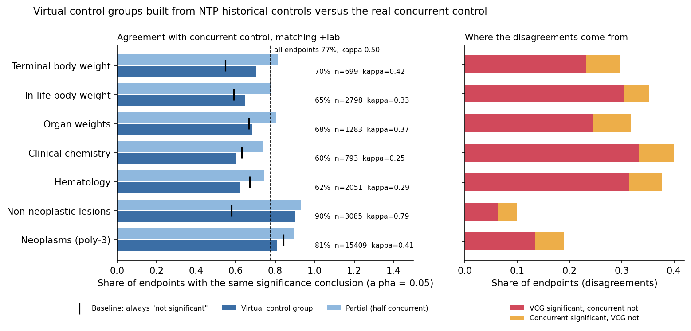
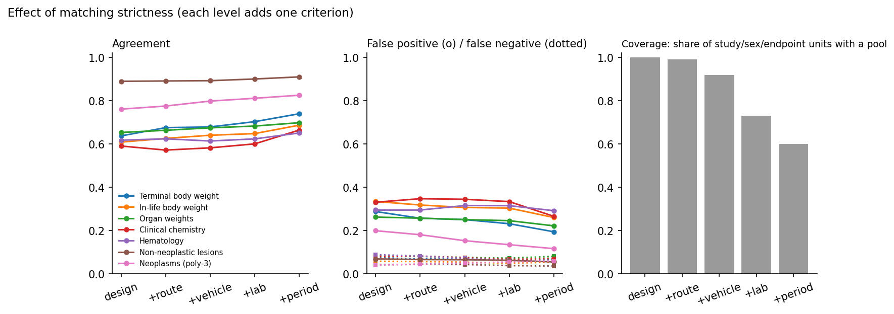
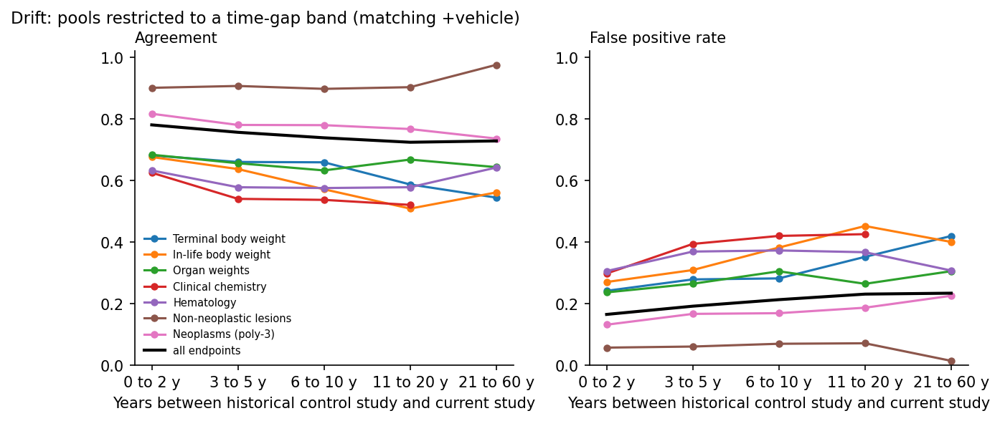
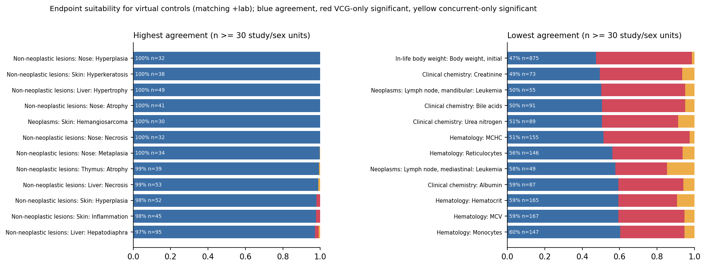

# Virtual control groups for NTP rodent toxicology studies

A proof of concept that replaces the concurrent control group of a U.S. National
Toxicology Program (NTP) rodent study with a *virtual control group* (VCG) built
from matched historical control animals of other NTP studies, and measures how
often the toxicological conclusion stays the same. Public individual-animal data
from NTP's CEBS database only.

**Headline result: with historical controls matched on species, strain, sex,
study design, route, vehicle and laboratory, a virtual control group reproduces
the concurrent-control significance conclusion for 77% of 26,118 study x sex x
endpoint units from 1,120 NTP studies (Cohen's kappa 0.50). Three quarters of the
disagreements are findings that are significant against the VCG but not against
the concurrent control. Agreement is far from uniform: 90% for non-neoplastic
lesion incidences, 81% for neoplasm incidences, but only 60-70% for clinical
pathology, organ weights and body weights, where a constant "not significant"
verdict would do about as well.**



Agreement is a comparison with the concurrent control, not with the truth. Nothing
here says what the right answer for any study is; it says how often a VCG would
have led to the same answer as the real control group did.

## Method in a few sentences

1. **Data.** Individual-animal clinical chemistry, hematology, organ weights,
   terminal and in-life body weights and histopathology from NTP's DTT data
   collections in CEBS, plus the CEBS study catalog (laboratory, start year,
   route, vehicle per study). F344 rats and B6C3F1/N mice; 3-month and 2-year
   studies with a simple dose-response design.
2. **Hold-out.** For every study and sex, the concurrent control group is set
   aside. Historical control animals are taken from *other* studies (same test
   article excluded) that match the target on species, strain, sex and study
   design, then increasingly also on route, vehicle, laboratory and start year
   (five nested strictness levels).
3. **Virtual control groups.** From the matched pool, 20 random groups
   of the same size as the concurrent control are drawn per configuration. A
   *partial* VCG keeps a random half of the concurrent animals and fills the other
   half from the pool. For the drift analysis the pool is restricted to historical
   studies a given number of years away.
4. **Tests.** Treated groups are compared with the control the way a toxicologist
   would: Dunnett's test (two-sided, 5%) for continuous endpoints, Fisher's exact
   test for non-neoplastic lesion incidences in 3-month studies and the poly-3
   test (Bailer-Portier with Bieler-Williams variance, one-sided) for neoplasm
   incidences in 2-year studies. Each comparison is run once against the real
   control and once against each VCG.
5. **Evaluation.** An endpoint is "significant" if any dose group is. Agreement is
   the share of endpoints with the same conclusion; a *false positive* is
   significant against the VCG only, a *false negative* significant against the
   concurrent control only. Rates are averaged over draws within an endpoint, then
   over endpoints.

## Results

All numbers below are from `results/tables/*.csv` and `results/summary.json`,
produced by the pipeline with the default seed. "Units" are study x sex x endpoint
combinations for which a historical pool of at least twice the concurrent group
size existed at the given matching level. Sensitivity is the share of
concurrent-significant endpoints also significant with the VCG; specificity the
share of concurrent-nonsignificant endpoints also nonsignificant with the VCG.

### Agreement by endpoint domain (matching: design + route + vehicle + laboratory)

| Endpoint domain | Units | Agreement | Baseline "never significant" | Kappa | Sensitivity | Specificity |
|---|---:|---:|---:|---:|---:|---:|
| Non-neoplastic lesions (Fisher, 3-month) | 3,085 | **0.90** | 0.58 | 0.79 | 0.93 | 0.85 |
| Neoplasms (poly-3, 2-year) | 15,409 | **0.81** | 0.84 | 0.41 | 0.65 | 0.84 |
| Terminal body weight | 699 | 0.70 | 0.55 | 0.42 | 0.85 | 0.58 |
| Organ weights | 1,283 | 0.68 | 0.67 | 0.37 | 0.78 | 0.63 |
| In-life body weight | 2,798 | 0.65 | 0.59 | 0.33 | 0.88 | 0.49 |
| Hematology | 2,051 | 0.62 | 0.67 | 0.29 | 0.81 | 0.53 |
| Clinical chemistry | 793 | 0.60 | 0.63 | 0.25 | 0.82 | 0.47 |
| **All endpoints** | 26,118 | **0.77** | 0.73 | 0.50 | 0.80 | 0.76 |

Two things stand out. First, the raw agreement for continuous endpoints is no
better than the trivial baseline of always calling the endpoint non-significant;
the VCG finds most of what the concurrent control finds (sensitivity 0.8-0.9) but
adds a significant finding to 37-53% of the endpoints the concurrent control
called quiet. Second, incidence endpoints agree well mostly because most lesions
are rare in both groups; for neoplasms the VCG misses a third of the
concurrent-significant sites (sensitivity 0.65), partly because the concurrent
poly-3 comparison is itself borderline for many rare tumours.

### False positives dominate, and the pre-dosing body weight shows why

Across all units, 17% are significant only against the VCG and 5% only against
the concurrent control. The clearest diagnostic is the **initial body weight**,
measured before any dosing: the concurrent comparison is significant for 5% of
units (chance level), the VCG comparison for about half. Historical animals of
the same strain, sex, laboratory and route simply do not weigh the same as the
animals in the current study, because age at arrival, supplier and the decade
differ, and nothing in the public metadata lets one match on those. The same
mechanism inflates differences in all body-weight-related endpoints and in
clinical pathology (creatinine, bile acids, urea nitrogen, MCHC and reticulocytes
have the lowest agreement among the continuous endpoints, 49-56%).

In a separate check, the concurrent control group differed significantly (Welch
test) from its own virtual replacement in 21-47% of draws depending on domain and
matching level, which is the direct measure of the same problem.

### Matching strictness

| Level | Criteria added | Units with a pool | Agreement | Kappa |
|---|---|---:|---:|---:|
| L0 | species, strain, sex, design | 35,729 (100%) | 0.73 | 0.43 |
| L1 | + route | 35,397 (99%) | 0.74 | 0.45 |
| L2 | + vehicle | 32,809 (92%) | 0.76 | 0.47 |
| L3 | + laboratory | 26,118 (73%) | 0.77 | 0.50 |
| L4 | + start year within 3 years | 21,464 (60%) | 0.79 | 0.53 |

Each criterion helps a little (6 points of agreement from L0 to L4, mostly by
removing false positives) and costs coverage: at the strictest level 40% of units
have no pool of sufficient size. Laboratory is the single most useful criterion.



### Partial virtual control groups

Keeping half of the concurrent control animals and replacing the other half
raises agreement from 0.77 to 0.86 (kappa 0.50 to 0.67) at the same matching
level and halves the false positive share (17% to 9%), while coverage improves
because a smaller pool suffices. This is the most practically interesting
configuration in these data: it reduces animals by a quarter of the control
group and keeps a concurrent anchor.

### Drift

With pools restricted to historical studies a given number of years away (at
matching level L2), agreement falls from 0.78 for studies within 2 years to 0.72
for studies 11-20 years apart, and the false positive share rises from 17% to
23%. The decline is steepest for in-life body weight (0.68 to 0.51) and clinical
chemistry (0.63 to 0.52); lesion incidences are flat.



### Most and least suitable endpoints

Most suitable are non-neoplastic lesions with clear treatment-related
incidences (nasal and skin lesions in inhalation and dermal studies, liver
hypertrophy and necrosis, thymus atrophy: 97-100% agreement) and common tumours
with stable background rates. Least suitable are the pre-dosing body weight (47%),
creatinine, bile acids, urea nitrogen, albumin, MCHC, reticulocytes, platelets
and the leukaemia incidences recorded in individual lymph nodes (49-61%).



### Negative and mixed findings, stated plainly

* For continuous endpoints the VCG built from public NTP data does not beat a
  constant "no effect" verdict on raw agreement. It is informative (kappa
  0.25-0.42) but not reliable.
* Stricter matching on the variables available publicly improves things only
  modestly; the missing covariates (age, supplier, initial body weight, fasting,
  analyser) are likely to matter more than the ones we have.
* The neoplasm result looks good on raw agreement and poor on sensitivity.
* Coverage and strictness trade off: a VCG that is well matched is often not
  available at all.


## How to reproduce

```bash
git clone https://github.com/Jkovv/virtual-control-groups-ntp
cd virtual-control-groups-ntp
pip install -r requirements.txt           # Python 3.11+, pinned versions
export VCG_DATA_DIR=/somewhere/with/10GB   # optional; default is ./data
make all                                   # download, prepare, evaluate, summarise
make test                                  # unit tests
make notebook                              # execute notebooks/walkthrough.ipynb
```

`make all` is equivalent to `python data/download_ntp.py` followed by
`python -m vcg.cli all`. The download is about 9 GB (two large CSV files; use
`DOWNLOAD_FLAGS=--skip-large` to skip them and lose the in-life body weight and
incidence endpoints). On a 12-core laptop the whole pipeline takes about
45 minutes after the download (about 8 min preparation, 17 min evaluation,
1 min summary). Results are deterministic for a given seed (`--seed`).

Repository layout:

```
data/        download script and data documentation (no data is committed)
src/vcg/     prepare (tidy tables), matching (pools, VCG draws), stats (tests),
             evaluation (comparison and summaries), plots, cli
notebooks/   walkthrough.ipynb: one study by hand, then the full results
results/     figures/*.png, tables/*.csv, summary.json
tests/       pytest suite (statistics against scipy, matching logic, evaluation on synthetic data)
```

## Limitations

* **Public NTP data only.** All animals come from NTP studies deposited in CEBS.
  Study attributes available for matching are those in the CEBS study catalog
  and the data collections: species, strain, sex, design, route, vehicle,
  laboratory and start year. Diet, supplier, housing, age at start, body weight
  at start, fasting state and analytical platform are not available and are
  known to matter for historical controls.
* **Rodent, two strains, two designs.** F344 rats and B6C3F1/N mice in 3-month
  and 2-year NTP designs. Nothing is implied about other species, strains,
  sponsors or study types.
* **The VCG is a random sample of pooled animals**, not a model. Animals from the
  same historical study are correlated, and sampling individuals ignores that
  structure. More elaborate VCG constructions (whole-group sampling, covariate
  weighting, generative models) are out of scope.
* **Statistics.** Dunnett's test only; NTP itself uses Williams' test when a
  monotone trend is present, and the pairwise poly-3 test here has no
  continuity correction. Significance at 5% is a crude stand-in for a
  toxicologist's judgement, which also weighs dose-response, magnitude,
  biological plausibility and historical ranges.
* **Incidence denominators** are the animals on study, not the animals whose
  tissue was examined; for lower dose groups of 3-month studies this
  under-counts incidences. Neoplasms are tested per site and morphology without
  the combinations (for example adenoma or carcinoma) that NTP reports.
* **The DTT collections are flagged by NTP as preliminary drafts** under review,
  and the in-life body weight collection is a 2025 release while the others are
  from 2026.
* **Not a regulatory validation.** This is a retrospective agreement study on one
  public data source. Concordance with the concurrent control is necessary but
  not sufficient for a VCG to be acceptable, and no claim is made that any
  concurrent control group could have been omitted.

## Data citation

National Toxicology Program (NTP) / Division of Translational Toxicology (DTT).
*DTT Integrated High Value Datasets: Clinical Chemistry, Hematology, Organ
Weight, Terminal Bodyweight, In-life Bodyweight and Histopathology Individual
Animal Data* (versions 2026-02 and 2025-07). Chemical Effects in Biological
Systems (CEBS), National Institute of Environmental Health Sciences.
https://doi.org/10.22427/NTP-DATA-110-021-001-000-6 (accessed 2026-10-21).

NTP. *CEBS Study Catalog*, DTT Data Collections Guided Search.
https://cebs-ext.niehs.nih.gov/datasets/search/cebs-study-catalog (accessed 2026-10-21).

NTP's Historical Controls database (https://ntp.niehs.nih.gov/data/controls) was
consulted but not used because it publishes group-level summaries, not animals.

## Related work

* Steger-Hartmann T, Kreuchwig A, Vaas L, et al. Introducing the concept of
  virtual control groups into preclinical toxicology testing. *ALTEX*
  2020;37(3):343-349. https://doi.org/10.14573/altex.2001311
* Gurjanov A, Kreuchwig A, Steger-Hartmann T, Vaas LAI. Hurdles and signposts on
  the road to virtual control groups: a case study illustrating the influence of
  anesthesia protocols on electrolyte levels in rats. *Front Pharmacol* 2023;14:1142534.
  https://doi.org/10.3389/fphar.2023.1142534
* Gurjanov A, Vaas LAI, Steger-Hartmann T. The road to virtual control groups and
  the importance of proper body weight selection. *ALTEX* 2024;41(4):660-665.
  https://doi.org/10.14573/altex.2403141
* Golden E, Allen D, Amberg A, et al. Toward implementing virtual control groups
  in nonclinical safety studies: workshop report and roadmap to implementation.
  *ALTEX* 2024;41(2):282-301. https://doi.org/10.14573/altex.2310041
* Andaya R, Sullivan R, Pourmohamad T, et al. A proof-of-concept rat toxicity
  study highlights the potential utility and challenges of virtual control
  groups. *ALTEX* 2024;41(4):647-659. https://doi.org/10.14573/altex.2404201
* **VICT3R** (Innovative Health Initiative, 2024-2028): a 30+ partner consortium
  building a shared historical control database, VCG methods and a standard
  operating procedure, with regulatory acceptance as the goal.
  https://www.ihi.europa.eu/projects-results/project-factsheets/vict3r;
  Steger-Hartmann T, et al. *Toxicol Pathol* 2025;53(2):230-233,
  https://doi.org/10.1177/01926233241303906
* **eTRANSAFE** (IMI2): the data-sharing project in which the VCG idea was
  first developed.
  https://www.ihi.europa.eu/projects-results/project-factsheets/etransafe
* **EMA.** On 31 March 2026 the CHMP released for consultation a *Draft
  qualification opinion for Virtual Control Groups (VCG) to replace Concurrent
  Control Groups (CCG) in rat non-GLP dose-range finding studies*, with the
  VICT3R *Standard Operating Procedure for the Implementation of Virtual Control
  Groups in Preclinical Studies* (v1.0) as its annex. It is the first
  qualification procedure for a new approach methodology in toxicity assessment.
  https://www.ema.europa.eu/en/news/ema-consults-virtual-control-groups-help-reduce-animal-use-medicines-development.
  See also EMA's page on regulatory acceptance of new approach methodologies:
  https://www.ema.europa.eu/en/human-regulatory-overview/research-development/ethical-use-animals-medicine-testing/regulatory-acceptance-new-approach-methodologies-nams-reduce-animal-use-testing
* **U.S. FDA.** *Roadmap to Reducing Animal Testing in Preclinical Safety Studies*
  (April 2025), https://www.fda.gov/media/186092/download, and the subsequent
  CDER draft guidance *General Considerations for the Use of New Approach
  Methodologies in Drug Development*. The roadmap does not mention virtual
  control groups; both set the regulatory direction in which VCG work sits.

The EMA context of use is deliberately narrow (non-GLP rat dose-range finding
studies, GLP-grade proprietary historical data, expert review of each VCG). This
repository is a small, fully reproducible public-data counterpart on a different
data source and study type. It is not a comparison with, or a replication of,
any of these results.

## License

MIT (see `LICENSE`). The NTP data are U.S. government works in the public domain;
please cite NTP/CEBS as above when you use them.
